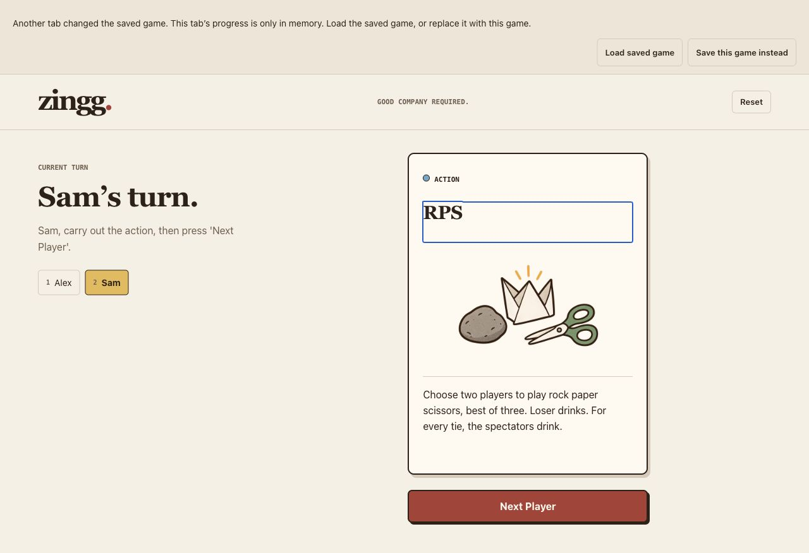
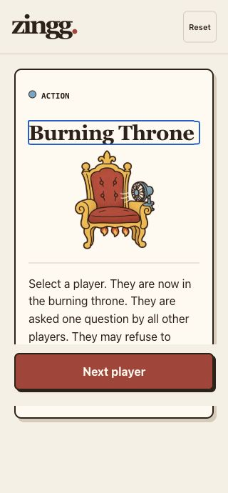
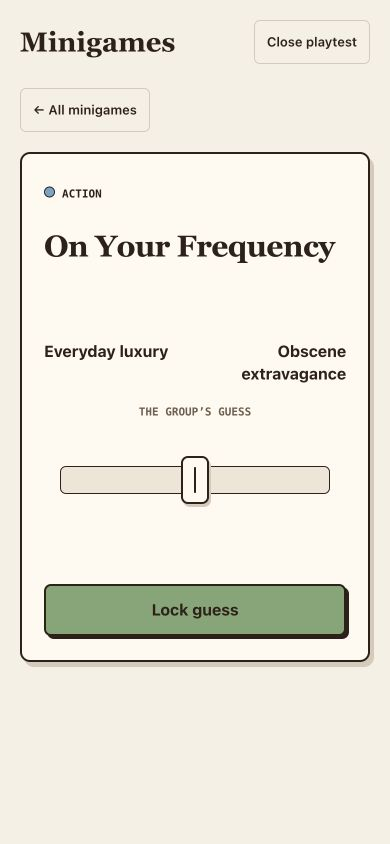
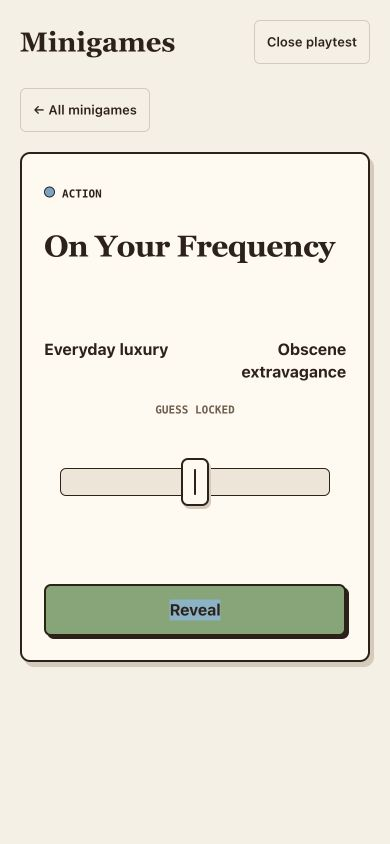

# Zingg audit fixes — October 22, 2026

Implemented on `master`, following the [codebase audit](./2026-10-22-codebase-sweep.md) of `6e5a0188ab8d19caf43a3b563c67b443253a40ff`. All fourteen bug and maintenance findings have been addressed. The validation below was completed locally before release; deployment status is tracked by the commit's GitHub Actions run. Larger feature ideas in the audit's improvement backlog remain deferred.

## Changes

| Audit finding | Fix | Verification |
| --- | --- | --- |
| F01 · Partial save corruption | Recover classic and mobile snapshots independently. Preserve valid roster, input, options, and the healthy mode. Explain recovery and retain the original envelope locally under `zingg-game-state-recovery-v1`. Explicit reset also clears that backup. | Both corruption directions, malformed/legacy rosters, retained settings, exact recovery copy, and reset cleanup are covered in `AppRecovery.test.tsx`. |
| F02 · Lost gameplay focus | Focus the revealed public card heading and the next turn heading in both game modes. Keep explicit exhausted-deck focus and reshuffle behavior. | Keyboard component regressions and real browser Enter → heading → Tab → next-player checks in classic and mobile. |
| F03 · Two-player Undercover | Add minimum-player metadata and skip ineligible cards for a known classic roster. Undercover requires three players. Keep indexed saved decks intact and skip consecutive unavailable cards without changing player order. Label the rosterless mobile card “For 3–12 players.” | Fresh/resumed two-player games, three-player eligibility, consecutive skips, terminal skips, and exhaustion/reshuffle tests. |
| F04 · Tooling advisories | Update Vite 8.0.10 → 8.1.6 and Vitest 4.1.5 → 4.1.12, with compatible patched transitive dependencies. Runtime dependencies are unchanged. | Locked install, validation, build, and full/production audits: zero vulnerabilities. |
| F05 · Analytics failures | Central tracking helper absorbs synchronous provider errors and rejected promises while retaining playtest suppression. | Analytics tests cover missing/throwing/rejecting providers and continued game actions. |
| F06 · Frequency rapid taps | Give phase actions separate identities and a 700ms guard. Hiding a visible secret remains immediately available. Guard replay handoff as well. | Fake-timer regressions plus real Chrome double-click checks at 390×844. Locking stays locked; replay does not reveal a secret from the previous tap. |
| F07 · Mobile Categories instructions | Start with the current player, then follow the roster or clockwise order when no roster is shown. | Catalog review; no deck indexes changed. |
| F08 · Outdated trivia | Change the nonconsecutive-presidency clue to “first US president,” with the typo corrected. | Catalog diff reviewed. |
| F09 · Invalid restored names | Trim names and corresponding saved player records together. Route blank/duplicate names to a repairable lobby. Preserve the saved deck, turn, statuses, and player order; prevent roster removal/addition or format changes until resume/reset. | Whitespace, blank, duplicate, saved-round resume, and healthy mobile preservation tests. |
| F10 · Home mode choice | Make the home selector reflect and persist the current play mode. | Mobile return/reload/radio tests and browser mode switching. |
| F11 · Stale-tab overwrites | Listen for external storage changes and compare the saved envelope before each write/reset. Pause persistence on a conflict while allowing memory-only play. Offer explicit “Load saved game” and “Save this game instead” choices. | Simulated delayed storage events, external reset, explicit replace/load, real two-tab reset, and denied-storage tests. |
| F12 · Excluded tooling types | Type-check Vite configuration and art tooling through `tsconfig.tooling.json`; use Vitest's configuration type for the test block. | `npm run compile` now checks both application and tooling. |
| F13 · Domain/config drift | Keep the single canonical `playzingg.com` CNAME; correct analytics' `www.playzingg.com` allowlist and document GitHub Pages Settings as deployment source of truth. | Config diff and production build inspected. No DNS or hosting mutation. |
| F14 · Virtual-camera assumptions | RPS and Day at the Races allow separate cameras with a shared countdown and visible hands/drinks. | Catalog review; live-specific variants remain intact. |

Review also caught and fixed three edge cases in the recovery implementation: initialization now derives the state and write baseline from one storage read; a failed explicit reload preserves the in-memory game; loading another lobby or removing an earlier roster row cannot assign an old rename draft to another player. Each has a regression test.

## Validation

| Check | Result |
| --- | --- |
| `npm ci` | Pass against updated lockfile |
| `npm run compile` | Pass, including tooling |
| `npm run lint` | Pass |
| `npm test` | 11 files, 156 tests pass; 38 more than the audit baseline |
| `npm run build` | Pass; 106 modules; application JS 266.36 kB / 83.25 kB gzip |
| `git diff --check` | Pass |
| Full dependency audit | [Zero findings](./2026-10-22/dependency-audit-fixed.json) |
| Production dependency audit | [Zero findings](./2026-10-22/dependency-audit-production-fixed.json) |
| Browser console, final verification tab | No warning/error entries |

Real browser checks covered two-player classic live and video games, keyboard reveal/next-player focus, mobile play, home selection and reload, independent mode resume, resizing, reset focus/escape/shift-tab, and a second-tab reset followed by continued stale-tab play and explicit reload. Tested widths were 320, 390, and 1280px, with no horizontal overflow observed in the checked lobby/game views. The separate Frequency check used Chrome at 390×844.

Saved-state corruption, name repair, exhaustion/reshuffle, and storage exceptions were verified through component tests. These checks are local browser and test evidence; they do not establish production deployment, physical-device, screen-reader, or full browser-matrix acceptance.

## Browser evidence

The original tab receives a conflict notice after another tab resets. It can keep playing in memory, and the reset remains saved until the user explicitly chooses otherwise:

Mobile keyboard reveal focuses the public title; Tab reaches Next player and advancing focuses the next choice heading. This 320px capture shows the existing scrollable card layout:

Frequency stays in the guessing phase after a rapid handoff and in the locked phase after a rapid lock:

## Limits and deferred work

- Browser localStorage has no atomic compare-and-swap. The guard prevents observed stale and sequential conflicting writes, including delayed-event resets; truly simultaneous writes remain best effort. A transactional cross-tab store/lock is a separate change if that guarantee becomes necessary.
- The recovery envelope stays on the device, is overwritten by later damaged-save recovery, and is removed by explicit reset. No recovery data is transmitted externally.
- Routine dependency monitoring remains an operational follow-up; the recorded zero-advisory result is time-specific.
- The audit's broader content, product, architecture, performance, accessibility, and instrumentation ideas remain in its improvement backlog. Frequency remains playtest-only and was not added to the deck.
